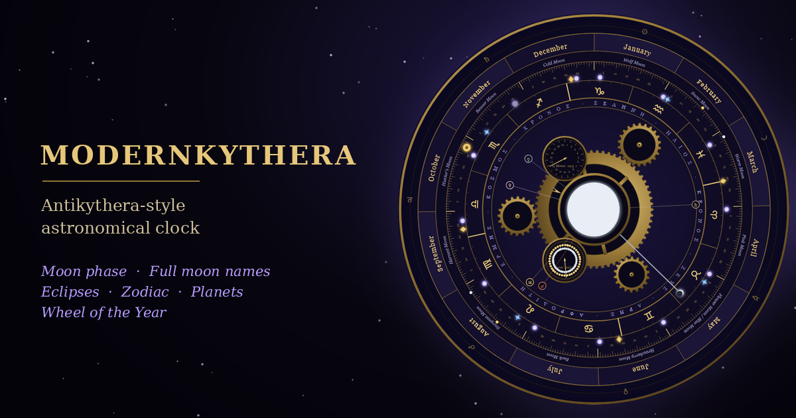

# Modernkythera

An interactive astronomical clock inspired by the ancient Antikythera mechanism.

Explore the movements of the Sun, Moon and planets through an interactive astronomical clock that combines celestial cycles, zodiac positions and seasonal traditions in a modern experience.

**[🌙 Open Modernkythera](https://millaceedee.github.io/Modernkythera/)**

## Features

- **Interactive astronomical clock** with real time and accelerated time modes
- **Moon phases** and full Moon dates
- **Sun, Moon and planetary positions**
- **Zodiac positions** for celestial bodies
- **Eclipses** and astronomical cycles
- **Seasonal festivals** and the Wheel of the Year
- **Daylight calculations** and solar graphs based on geographic coordinates
- **Metonic and Saros cycles**
- **Bilingual support** (English and Finnish with a quick toggle)
- **Interactive visual elements** with hover and tap details
- **Zoom controls** for exploring the clock

## How It Works (Astronomical Calculations)

Modernkythera calculates all celestial movements, phases, and cycles entirely client-side using native JavaScript. **No APIs, no servers, and no internet connection are required.**

- **Moon Phases & Full Moons:** Powered by Jean Meeus’s *Astronomical Algorithms* (specifically algorithms for lunar phases, such as Chapter 49).
- **Solar & Planetary Positions:** Uses rigorous orbital mechanics and astronomical series approximations to track the Sun, Moon, and visible planets along the zodiac.
- **Eclipses & Cycles:** Computes Saros and Metonic cycles algorithmically to display historical and future solar and lunar eclipses directly within the mechanism.

## About

Modernkythera is a personal project exploring astronomy, celestial cycles and the relationship between ancient astronomical ideas and modern interactive software.

The project takes inspiration from the Antikythera mechanism, an ancient device associated with astronomical calculations and the tracking of celestial cycles.

## Try it online

You can use the clock directly in your browser without installing anything.

## Source code

The source code is available in this repository. You are welcome to explore it, learn from it and build upon it under the terms of the MIT License.

## Tutorial

Want to learn how I built Modernkythera?

I've created a mini tutorial showing how I made this interactive astronomical clock. The tutorial is available on Patreon behind a paywall.

**[📖 Read the Modernkythera mini tutorial on Patreon](https://www.patreon.com/Millaceedee/posts/meet-build-your-173601553)** 🔒

## Original creator

Created by **Millaceedee** in 2026.

If you share or redistribute this project, please retain the original copyright notice and the MIT License.

## License

This project is licensed under the MIT License. See the [LICENSE](LICENSE) file for details.